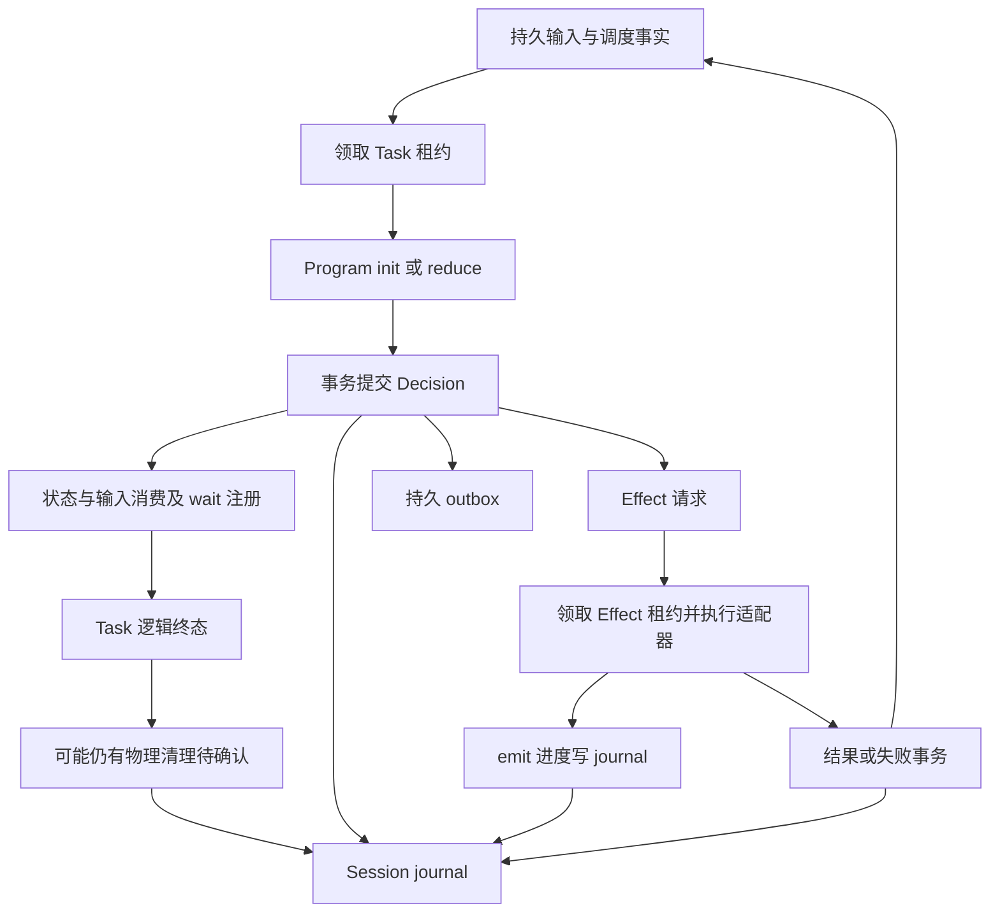
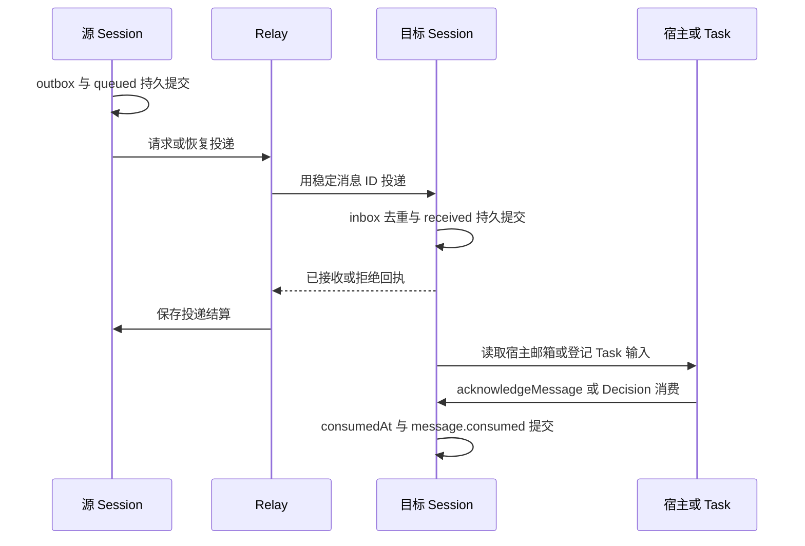

# durable-kernel 事件契约

本文描述 0.1.0 当前行为。接口签名及生命周期见 [API 参考](./api.md)。新事件使用 v2 信封；逻辑终态、物理清理、控制确认和观察取消分别建模。

## 四类通道

`session.identity.assigned` 使用 SessionRecord payload 和 v2 信封，只在旧 Session 首次取得存储 incarnation 时持久登记。新 Session 的 instanceId 随原 session.created 保存；归档导入生成新的存储 incarnation。Task 创建事件可包含只读 ownedBy 关联，调用状态仍来自原 Task/Effect 记录，不增加另一套调用状态事件。task.call.execute/cancel 是 onDiagnostic 操作名称，不是 reducer 输入或 EventEnvelope 事件。

| 通道 | 是否持久 | 消费用途 |
| --- | --- | --- |
| `TaskInputEvent` | 通过 Task pendingEvents / 等待事实持久化 | reducer 的输入，如 signal、message、effect-completed |
| `EventEnvelope` journal | 写入 Session 的 events.seq | 业务观察、进度展示、按 sequence 补读 |
| `Kernel.onChanged` | 否 | 存储变化后的失效 / 唤醒通知；回调后重新读取，不计为一次业务事件 |
| `onDiagnostic` | 否 | 本实例安全诊断，记录阶段、错误分类和耗时 |

`agent.event` 等自定义事件可以经 Effect context.emit 或 Decision.emit 写入同一个 journal；嵌套业务事件的类型、文本 delta 和去重由上层协议负责。Kernel 不内置 Claude / Codex 的聊天 turn、item 或内容块语义。

恢复的依据是持久 Task 状态、pendingEvents、wait 注册、租约和收据，不是简单重放 EventEnvelope 就能重建整个执行状态。不要将 UI journal 当作 reducer 输入队列，也不要将 onChanged 当作可靠消息总线。

## 信封与顺序

```ts
interface EventEnvelope {
    schemaVersion?: number;
    sequence: number;
    sessionId: string;
    taskId?: string;
    effectId?: string;
    attemptId?: string;
    type: string;
    payload?: unknown;
    occurredAt: number;
}
```

新写记录使用 schemaVersion 2；旧 v1 记录允许缺省。首次新事件写入同时提升 Session manifest 的 events 与 index schema，旧 writer 必须退出后再升级；只读查询不会升级。sequence 在每个 Session 的事件日志内递增；不同 Session 没有可比较的全局序号。Task watch 保留原 Session sequence，因此相邻 Task 事件不必连续。occurredAt 用于展示，不能代替 sequence 判断提交顺序。

事件与同次存储变更在一个事务中提交。持久记录可补读；进程内唤醒可能合并、遗漏或跨进程不可见，观察者仍应以 journal / 快照为准。同一 Session 事务中多个事件有顺序，但不能将中途某个 Task 终态事件解释为该事务的最后一个事件。

通用 EventEnvelope 仍允许 type: string / payload: unknown。KernelEventMap 与 KernelEvent 为已收录内建事件提供判别联合；parseEventEnvelope 校验信封，parseKernelEvent 校验 v2 内建 payload 和关联身份。旧 v1、应用及尚未收录事件返回 undefined，消费端保留原记录并交给领域解析器。非法已知 v2 事件抛 EVENT_INVALID，不猜测补齐旧记录身份。

## 执行链



典型单 Effect 路径：`task.created → task.leased → task.waiting → effect.leased → 自定义进度 → effect.succeeded/failed → task.leased → task.succeeded/failed`。这是示意，不是要求严格交替的全局序列；并发 Task、重试、控制和业务事件会穿插，wait 命中也不要求每个 Effect 都恰好触发一次 reducer。

Decision 提交先写本步 `task.<status>`，再写 shared / 自定义 emit / 输入消费 / outbox 等事件。因此终态之后仍可能有同次 Decision 的业务事件。异步清理确认还可能在更晚的事务出现。

## 主要事件族与当前 payload

下表列出主要生命周期事件。KernelEventMap 收录 Session 状态、Task 创建 / 领取 / 终态 / 控制、Effect 生命周期与消息结算；其他领域事件仍由其领域校验器解释。

| 事件 | 当前含义与注意点 |
| --- | --- |
| `session.created`、`session.open`、`session.suspending`、`session.suspended`、`session.closing`、`session.closed` | Session 状态记录；解除暂停目前命名为 session.open |
| `task.created`、`task.spawned`、`task.started` | 提交、结构化子任务创建和启动 |
| `task.leased`、`task.attempt.lost`、`task.retry.scheduled` | reducer attempt、失权与重试 |
| `task.ready`、`task.waiting`、`task.succeeded`、`task.failed`、`task.cancelled` | Task 状态迁移；succeeded / failed / cancelled 统一携带 ExitRecord，输出仍可通过 poll / snapshot 核对 |
| `task.signal` | 输入已持久登记，不代表 reducer 已处理 |
| `task.control.pause`、`task.control.interrupt`、`task.control.run` | TaskControl 请求回执 |
| `task.control.withdraw-pause` | 显式撤销尚未确认的 pause；载荷为 mode=run 的 TaskControl，保留其他控制所有者的 hold |
| `task.control.acknowledged` | 控制确认记录；与控制 epoch / requestId 关联，不等于 Task 终态 |
| `task.interaction.requested`、`task.interaction.resolved` | 交互登记与回答保存 |
| `effect.leased` | payload 为 EffectAttempt，信封含 effectId / attemptId |
| `effect.succeeded`、`effect.failed`、`effect.indeterminate` | payload 为完成结果 / 错误，信封始终含 effectId / attemptId |
| `effect.retry.scheduled`、`effect.resolved`、`effect.cleanup.confirmed` | payload 分别含重试元数据、人工裁决、清理确认；信封含 effectId，有历史 attempt 时含 attemptId |
| `effect.interrupt.requested` | 中止意图与旧 attempt fencing 同事务，信封含 effectId / attemptId，之后异步取消 |
| Effect `context.emit` 写入的自定义事件 | 有效 Effect claim 下携带 envelope.effectId / attemptId；失权后拒绝写入 |
| `session.message.queued` | 源方 outbox 已登记；Session 与 Task 发送路径统一为消息记录 |
| `session.message.received` | 目标 inbox 持久接收，payload 为消息记录 |
| `session.message.delivered` / `session.message.rejected` | 源方投递结算或目标拒绝事实；必须结合 sessionId / 消息身份识别方向 |
| `message.consumed` | 目标消费者已确认，payload 含 messageId |
| `session.message.settlement-acknowledged` | 双方已补齐投递结算记录，不表示业务回复 |
| `task.events.pruned`、`task.history.compacted`、`session.messages.pruned` | 保留期维护事实，不应重新驱动业务执行 |
| `resource.requested` / `resource.resolved`、`cache.*`、`budget.*`、`session.shared.*`、`session.context.*` | 各领域的请求 / 收据 / 状态变更；请求受理不能替代结果检查 |

关联键为 Session / Task / Effect / attempt 身份；逻辑 effectId 与幂等键在重试间稳定，attemptId 每次改变。不得靠事件相邻位置或相同 result 关联并发操作。旧 v1 缺失的关联仍无法从快照补回；解析器不伪造历史事实。自定义 Decision / Effect emit 禁止使用内核的八类保留前缀，应用可使用 agent.event、app.* 等拥有的名字。

## 消息链



接收和源方结算之间可以崩溃并重试；重试不重复登记目标输入。同 Session 路径可以在本地事务完成，不要求额外的源方 delivered 事件。消费者可以在源方结算前处理消息；不能按上图箭头顺序推导跨 Session 全局顺序。

宿主读取后执行外部操作再确认消费，必须能幂等重试。Task 输入消费与 Decision 同事务。消费游标使用目标 deliverySequence，journal 使用 Session sequence；二者与 correlationId、业务处理完成回执都不是同一个概念。

## 订阅、补读和裁剪

Session / Task 均提供 `readEvents({afterSequence?, throughSequence?, limit?})`，默认 limit 100，范围 1–500；返回 `{items, throughSequence, nextAfterSequence?}`。afterSequence 和 watch.after 均为 Session sequence，排除下界。Task 过滤后不连续，不能用 previous + 1 检测断档。

首个页面固定 throughSequence，后续带上它和 nextAfterSequence，直到无下一页，再将 throughSequence 作为下次增量起点。每页在一个事务中检查保留水位并读取范围。Task 索引使用二分定位原 Session sequence，Session 使用序号范围批读；不因重连而从头扫描所有事件。

缺少 Task 事件索引的旧数据首次读取时，仍需同事务补建派生索引，成本随历史事件数量增长；后续分页复用该索引。这不升级 manifest、不登记执行 worker，也不修改业务状态。

watch 使用同一分页接口，每页 100 条。消费者处理后再保存 cursor；外部业务处理与 cursor 持久化通常不同事务，需幂等。慢消费者不阻止生产者继续持久执行，也不能阻止 retention。

新裁剪在删除事件的同一事务记录 Task 和 Session 的 pruned-through-sequence。旧的 Task index 水位可保守推导过期边界。`readEvents` / `watch` 在 cursor 已落后于裁剪边界时抛 **CURSOR_EXPIRED**，details 只包含作用域和边界；缺失记录 / 错误索引为 STORAGE_CORRUPT，不静默跳过。

重同步步骤：

1. 丢弃旧事件投影，读取 `task.snapshot()` 或 `session.snapshot()`。
2. 用权威状态重建视图；snapshot.asOfSequence 与状态同事务读取。
3. 从该 asOfSequence 开始补读 / watch，合并后续增量。

Task 快照包含一个 Task，Session 快照显式读取整个成员集合；后者成本随 Task 数量增长。快照恢复当前视图，不恢复已裁剪的完整审计历史。根兼容 taskEventPage 仍采用 Task index 并报告 firstAvailableIndex；不要将它的游标混入新 sequence API。

## 停止与流结束

| 接口 / 状态 | 完成边界 |
| --- | --- |
| `task.poll()` / 默认 `task.wait()` | ExitRecord 已持久，即逻辑终态 |
| `task.wait({until: 'settled'})` | 逻辑终态且全部 Effect 已确定、清理完成 |
| 默认 `task.watch()` | settled 后再次排空最终页面，包含 effect.cleanup.confirmed |
| `task.watch({until: 'exit'})` | 只等待逻辑终态并排空当时页面；以后清理事件需另行读取 |
| `task.waitStopped()` | 此次 Task 控制已确认或已清理的终态，返回 TaskStat；不自行发控制命令 |
| `session.watch()` | closed / archived 后再次排空；暂停不结束订阅 |
| `watch({signal})` | 抛 ABORTED，只结束观察，Task 保持原执行意图 |
| Harness dispose / shutdown | 事件流结束；未完成的 wait / waitStopped 抛 DISPOSED，重建后重新附加句柄 |

watch 取消会释放 listener / timer，挂起的 next 可以结束；不能取消的底层只读 IO 允许自行完成。break 在 yield 点关闭迭代器。观察边界检查和额外排空避免同次事务中终态之后的业务事件被截断；unknown / indeterminate 操作不会被视作 settled。

## interrupt 与恢复顺序

pause 持久关闭调度并使 reducer 失权，Effect 自行排空。interrupt 在同一事务将树内在途 Effect 标为 pending + cleanupPending、记旧 attempt 为 lost，并写 effect.interrupt.requested / 控制回执。旧 attempt 的结果、进度和带 claim 的共享写入此后都拒绝提交。

本地控制器收到 abort；当前或替代 worker 按持久意图调用 adapter.cancel。仅在适配器确认物理停止后，事务清理 cleanupPending 并写 effect.cleanup.confirmed。树内有未确认操作时，根控制回执必须保持 acknowledged: false；随后写 task.control.acknowledged。缺失、失败或挂起的适配器不会伪造确认。

resume 仍使用原 Task 和逻辑 Effect 身份。旧 attempt 已 lost，下一次执行先 reconcile；明确安全的幂等重试策略才允许重放，未知结果保留 indeterminate 并供人工裁决。绝对 Effect deadline 不因暂停重置。

适配器的 execute / reconcile / cancel context 包含 attemptId 与单调 attemptNumber，跨进程的外部资源必须据此实现执行屏障，使取消确认后旧 attempt 不能迟到启动。内核保证持久提交权和清理责任，外部服务是否已停止仍由适配器核对；任意 JavaScript 栈和无协议的外部副作用不具备自动 exactly-once 保证。


## 输入、调度与宿主通知

signal 的接纳回执不是 Task 执行完成事件；稳定 requestId 重放不再次追加 task.signal。终态拒绝新的 signal；先前接纳的请求仍返回原回执。Task 与 Session 的 watch / wait 不因上层文件通知而改变执行意图。

session.schedule 使用 kernel.schedule@1 Program、timer wait 和普通 task.created / task 终态事件。timer-fired 新记录附带 firedAt，表示核对时刻；skip / catch-up 计算只依赖已持久输入。一次调度提交的回执、一次轮次子 Task 的创建、该子 Task 的完成是不同边界。

session.archive.imported 的 payload 为 {mode, archiveId}，与导入记录和回执同事务写入。它表示暂停的归档已接纳，不表示已经 resume、外部资源已重新绑定或原执行者已停止。

内核 onChanged 和 VFS node:* / seq:committed 是宿主通知，不是持久事件。默认 rescanMs 补扫按后端批量读提交水位；未变化时不扫描任务。外部文件 watcher、IPC 和可靠唤醒桥的职责见[存储与通知](./storage.md)。

Session 内提交仍发送带所属 Session 身份的变化通知，执行轮询仅调度本 Session。已有依赖观察者可据通知重新核对目标状态，跨 Session 投递通过接收方持久输入唤醒；不以是否存在 UI 订阅决定后台任务能否运行。catalog 变更继续唤醒已登记 Session，跨进程漏通知由持久提交水位核对补偿。进程内订阅不能替代持久 wait、租约或重启恢复。

## 活动总览的失效

`onChanged({reason: 'structure'})` 表示视图应重读，既可来自本实例提交，也可来自跨进程活动/Session 控制水位变化；回调次数不等于状态迁移次数。`reason: 'content'` 仍唤醒事件观察者和调度，但不应刷新整棵侧栏。使用 sessionActivity 的 pending 数量重建待办，不能把 requested / resolved 临时通知转换成永不核对的布尔值。回答一个问题不能清除同 Session 下其他 Task 的待办。

`effect.indeterminate` 同时适用于恢复核对未知与适配器显式分类的实时未知结果。两者均不投递 `effect-failed` 给Program，不自动重试，等待现有显式Effect处理接口；事件结构不变。

Cancellation admission receipts are stored atomically with the existing terminal Task write; they do not add a second terminal event. A replay emits no duplicate `task.cancelled`. If completion won the race, the receipt records its real status and does not emit `task.cancelled`. Physical cleanup continues to use `effect.cleanup.confirmed`; neither the receipt nor the logical terminal event proves that resources have been released. Diagnostic `task.cancel` distinguishes `admission`, `cleanup`, and `terminal-observed`, includes request correlation and duration, and omits the cancellation reason and adapter error text.

Interaction responses with an optional requestId persist `responseRequestId` on the resolved interaction atomically with the answer and the existing `task.interaction.resolved` event. Replaying the original ID and value emits no second event. The event payload remains `{interactionId}`; prompt/answer bodies are not added to response diagnostics or the read-only response receipt.

### Remaining-tree cancellation admission

`task.tree-cancellation.requested` (schema v2) carries a `TaskTreeCancellationReceipt`:
`requestId`, matching `taskId`, nonnegative integer `expectedEpoch` / `controlEpoch`,
`rootStatus` (`succeeded` / `failed` / `cancelled`), `acceptedAt`, and positive integer
`taskCount` (including the root). It is committed once with all member cancellation records
and the durable receipt. It does not replace the original root exit event and does not imply
cleanup confirmation; use Task facts and `effect.cleanup.confirmed` for settlement.

Task 归属的持久执行事件同时更新 events.seq 的 last-execution-activity-at，供 sessionActivity 冷读活动时间；不复制事件正文。日志裁剪 task.events.pruned、无 Task 的结构事件及不会发出执行事件的租约心跳不更新该时间。旧存储可缺省该派生字段。
